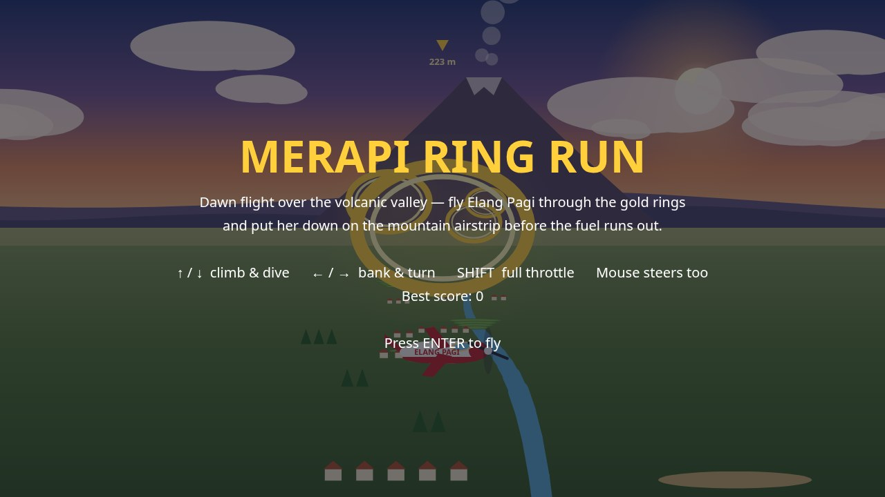
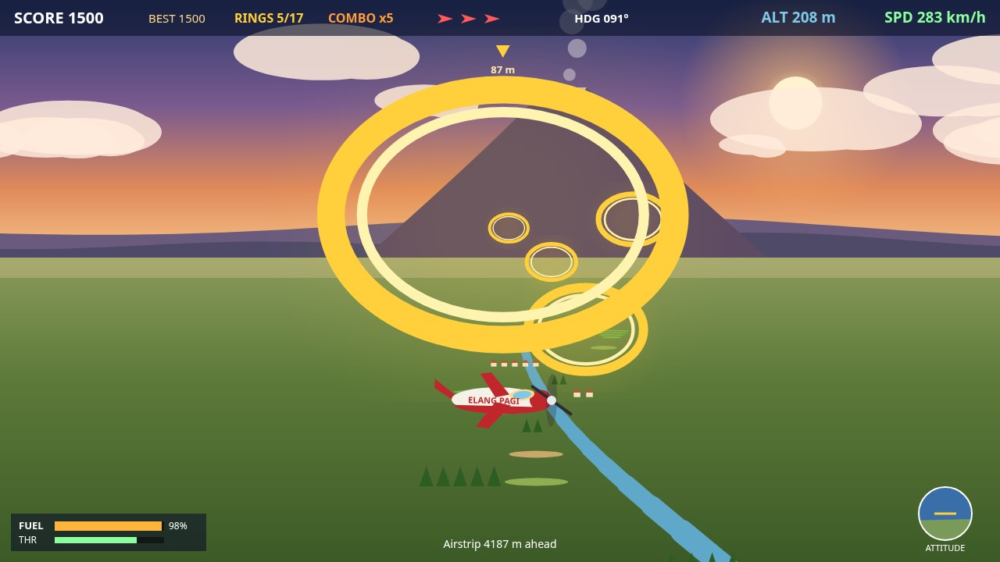
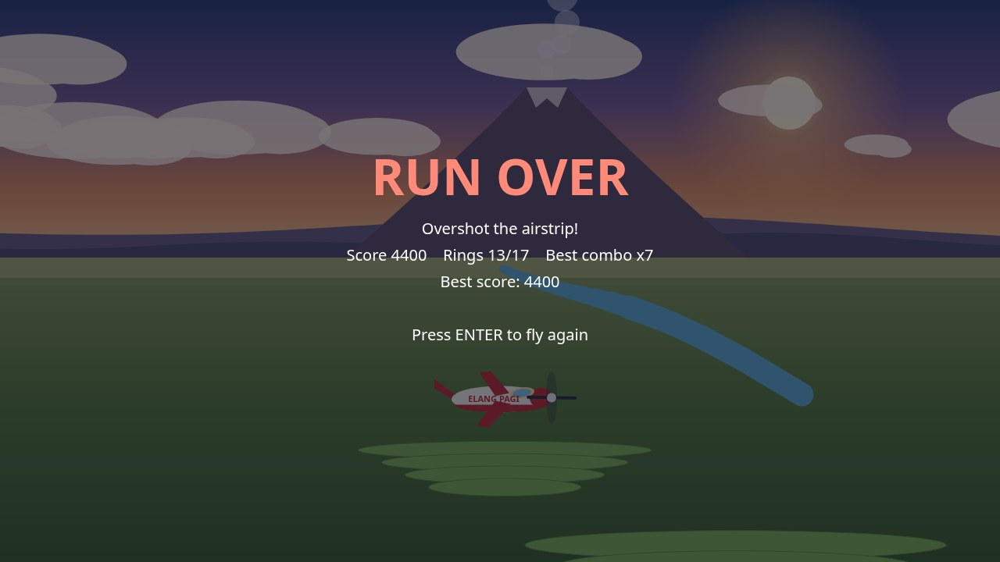

# Merapi Ring Run

[](https://make.fun/competitions/best-flight-game-20261126-0057?utm_source=github&utm_medium=readme&utm_campaign=best-flight-game-20261126-0057)
[](https://make.fun/competitions/best-flight-game-20261126-0057?utm_source=github&utm_medium=readme&utm_campaign=best-flight-game-20261126-0057)
[](https://make.fun/competitions/best-flight-game-20261126-0057?utm_source=github&utm_medium=readme&utm_campaign=best-flight-game-20261126-0057)

A dawn flight over an Indonesian volcanic valley. Fly the little
red-and-white prop plane **Elang Pagi** down the valley at sunrise —
past the smoking Merapi cone, over rice terraces, river and villages —
through 17 gold rings, and put her down on the mountain airstrip before
the fuel runs out.

An original, complete flight game for the make.fun
[best-flight-game](https://make.fun/competitions/best-flight-game-20261126-0057)
competition. Everything is drawn in code and all sound is synthesized —
no copied assets, no libraries, no network.

## How to play

Serve the game and open it in a desktop browser:

```sh
node serve.ts        # serves game/ on http://localhost:8080
```

Or open `game/index.html` through any static server.

- **↑ / ↓** — climb & dive
- **← / →** — bank & turn (heading follows the bank)
- **Shift** — full throttle · **Ctrl** — throttle back
- **Mouse** — steers too (move the pointer; keyboard always wins)
- **Enter** — start / restart · **P** — pause · **M** — mute

Fly through a gold ring to score (100 × combo) and top up the fuel.
Miss one and the combo resets. Hit the terrain and you lose a life —
three lives, then the run is over. Land on the airstrip (low and slow,
inside the runway) to finish the run with a fuel + lives bonus. Your
best score is saved in the browser.

## What's inside

- `game/` — the playable game, plain static files:
  - `index.html` — canvas + help line
  - `src/config.js` — tuning and the 17-ring course
  - `src/world.js` — simulation: flight, rings, fuel, terrain, landing
  - `src/render.js` — all art drawn in code (dawn sky, volcano, terraces,
    river, villages, airstrip, rings, plane, HUD with altitude / speed /
    heading, fuel, attitude indicator)
  - `src/input.js` — keyboard + mouse
  - `src/audio.js` — synthesized WebAudio effects
  - `src/shots.js` — deterministic screenshot scenes (`?shot=start|play|end`)
  - `src/main.js` — bootstrap + fixed-step loop
- `screenshots/` — three real renders of the game's own code, 1280×720
- `main.ts` — the hand-in program (Node 22, stdlib only): copies `game/`
  and `screenshots/` to `/output` and writes `/output/dossier.json`
- `vendor/makefun-game.ts` — the make.fun library, copied from the kit unchanged
- `serve.ts` — a tiny static server for local play (development convenience)

## Screenshots

| | |
|---|---|
|  | Title screen over the valley at dawn |
|  | Mid-flight through the rings, combo ×5 |
|  | Run over — overshot the airstrip |

## License

MIT — see [LICENSE](LICENSE).
